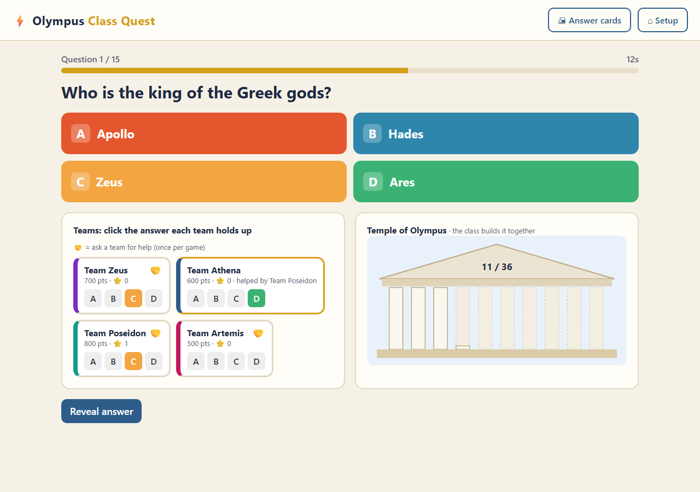

# Olympus Class Quest

A classroom quiz the whole class wins together.

**Play:** https://corebit-studios.itch.io/olympus-class-quest · **Demo video:** https://youtu.be/MmZZ2YTmpvk

## How it works
- Split the class into 2–6 teams and project the page on the board. Teams hold up printed A/B/C/D cards (the app prints them).
- The teacher clicks each team's answer, then reveals the solution.
- Every correct answer from **any** team adds a stone to the shared **Temple of Olympus**. Teams compete for points, but the temple is only finished if the whole class learns together.
- Once per game a stuck team can press 🤝 to ask another team for help. If the answer is right, both teams score and the helpers earn a ⭐ Kindness star.
- 30 built-in questions (Greek & Roman mythology, first Latin words). Teachers can paste their own: `question | right | wrong | wrong | wrong`.

## Run it
Open `index.html` in any browser. No install, no server, no accounts, no student data.

## Tech
One HTML file: plain JavaScript, CSS, SVG (temple), Web Audio API (sounds), print CSS (answer cards).

## AI use
The core idea is mine (Apjok Gergő, 14, Hungary), from my app-idea notes. Claude (an AI agent by Anthropic) proposed the cooperative features, designed and wrote the code and wrote the quiz questions at my request. I reviewed the submission.

## License
MIT
